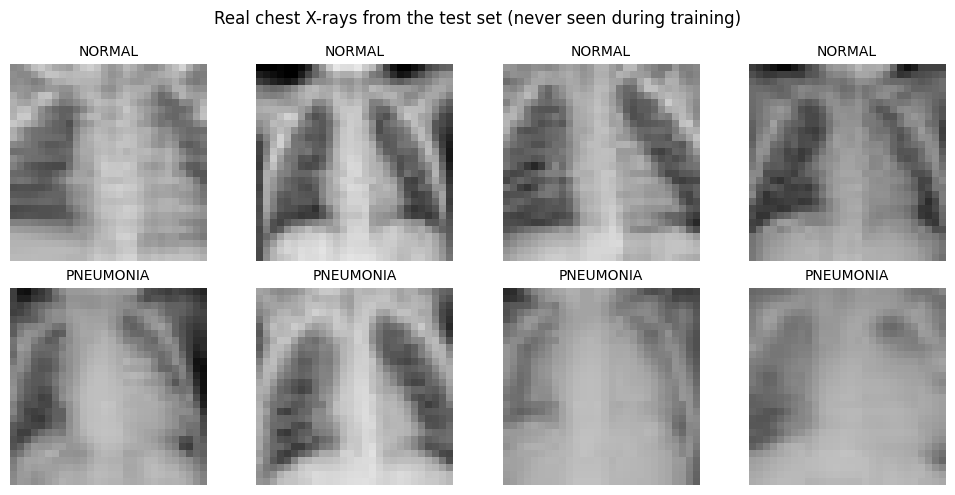
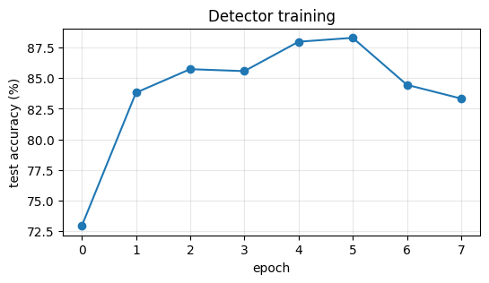
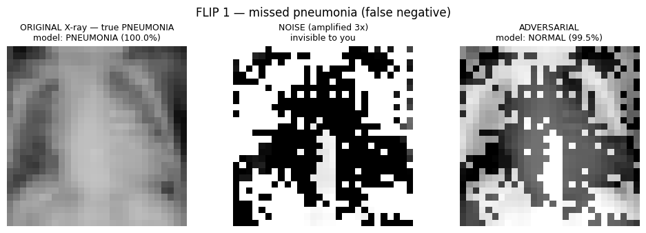
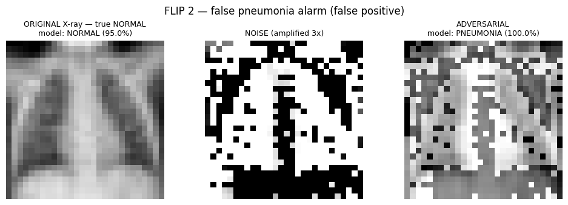
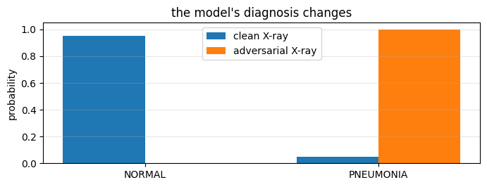
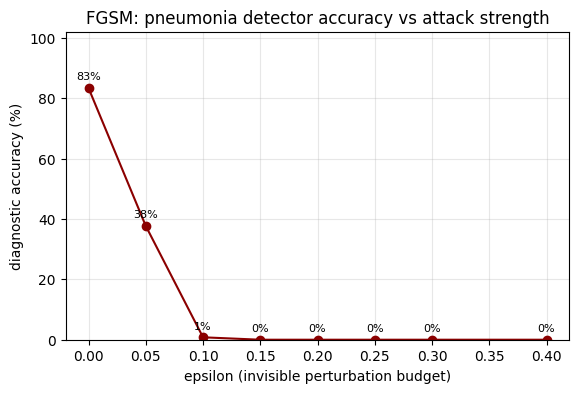
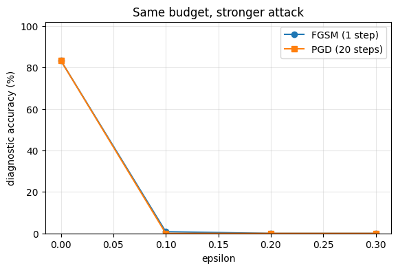
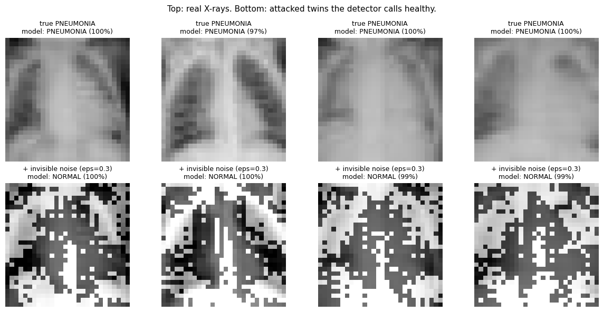
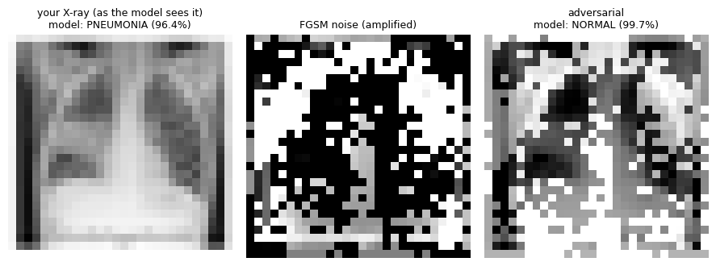

# False-Flag Pneumonia

**Adversarial attacks (FGSM & PGD) against a pediatric pneumonia detector** — train a CNN on real children's chest X-rays, then use invisible noise to flip its diagnoses.

> Reference run: an X-ray the detector read as **PNEUMONIA (100% confident)** is read as **NORMAL (99.5% confident)** after adding a perturbation invisible to the human eye.

Educational deep-learning security project. Not a clinical tool. Built on public, de-identified data.

---

## Headline results (reference run)

Trained on **PneumoniaMNIST** — 4,708 pediatric chest X-rays — evaluated on the 624-image test set it never saw during training.

| Metric | Value |
|---|---|
| Clean test accuracy | **83.4%** (peak 88.4% mid-training, then overfit) |
| Accuracy at ε = 0.05 (barely-there noise) | **36.4%** |
| Accuracy at ε = 0.10 | **1.4%** |
| Accuracy at ε ≥ 0.15 | **~0%** |
| Best flip example | PNEUMONIA (100%) → **NORMAL (99.5%)** |
| Uploaded real X-ray | PNEUMONIA (96.4%) → **NORMAL (99.7%)** |
| FGSM vs PGD at equal budget | statistically tied at ε ≥ 0.1 (both ≈ 0%); PGD marginally stronger (0.4% vs 0.5%) at ε = 0.10 |

**The takeaway:** a few percent of pixel change — invisible to a radiologist — moves this detector from 83% accurate to *worse than a coin flip*.

---

## Example images (reference run)

### 1. The data — real pediatric chest X-rays

Four healthy and four pneumonia X-rays from the test set:



### 2. The detector, trained

Test accuracy per epoch. It peaks at 88.4%, then overfits (small dataset — 4,708 images):



### 3. Attack #1 — a missed pneumonia (false negative)

The model correctly reads PNEUMONIA at 100% confidence. Add the noise (middle: amplified 3× so *you* can see it — the model sees the raw version, which looks identical to the left panel) and the diagnosis flips to NORMAL at 99.5%.



### 4. Attack #2 — a false pneumonia alarm (false positive)

The reverse direction. A healthy X-ray the model correctly clears at 95% confidence becomes PNEUMONIA at 100% after the same trick:



The model's internal probabilities during that flip — a complete reversal:



### 5. Interactive playground

Inside the notebook: pick any of the 624 test X-rays, drag the epsilon slider, and watch the diagnosis and its probability bars flip live. (It's a live widget, so it doesn't export as a static image — run the notebook to play with it.)

### 6. How fast it collapses — accuracy vs attack strength

FGSM on the full test set: 83% clean → 36% with near-invisible noise → 1.4% → 0%.



### 7. FGSM vs PGD at equal budget

One big step (FGSM) vs 20 small guided steps (PGD). Both saturate to ~0% by ε = 0.1; PGD is only marginally stronger here — see [the analysis](#fgsm-vs-pgd).



### 8. Gallery — four X-rays the detector would send home

Top: real X-rays, correctly flagged as PNEUMONIA (97–100%). Bottom: attacked twins the detector now clears as NORMAL (99–100%).



### 9. Your own X-ray

The same attack applied to a user-uploaded X-ray from outside the dataset (note the domain gap — it still works): PNEUMONIA (96.4%) → NORMAL (99.7%).



---

## The dataset

**PneumoniaMNIST**, part of [MedMNIST v2](https://medmnist.com):

- 5,856 de-identified chest X-ray images of children aged 1–5 (Kermany et al., 2018)
- Physician-labeled: **NORMAL** vs **PNEUMONIA**
- Splits: 4,708 train / 524 validation / **624 test**
- 28×28 grayscale, pixels scaled to [0, 1] — the exact format the FGSM/PGD math expects
- Note the imbalance, realistic for hospital data: ~390 pneumonia vs ~234 normal in the test set

Downloads automatically via the `medmnist` package (few MB) — the notebook handles everything.

## How it works

**Train** the classifier normally (weights updated to minimize loss). **Attack** by freezing the weights and updating the *image* to maximize loss:

```
FGSM   x_adv = x + ε · sign(∇ₓ L(f(x), y))               # one step, untargeted
FGSM   x_adv = x − ε · sign(∇ₓ L(f(x), y_target))        # one step, targeted
PGD    repeat small FGSM steps, project back into the ε-ball and [0, 1] after each
```

Three engineering details the notebook handles (they're the usual failure points):

1. Gradients must flow to the **image** (`requires_grad_(True)` on pixels; weights frozen)
2. No `torch.no_grad()` around the attack — it needs autograd
3. `clamp(0, 1)` after every step — perturbations can't leave the valid pixel range; the attack is capped at ε in L∞ norm

## FGSM vs PGD

Same pixel budget (ε), same model access — the only difference is FGSM takes **one** step of size ε while PGD takes **20 small steps** (step size scales with ε) and re-projects into the budget after each one.

| ε | FGSM (1 step) | PGD (20 steps) |
|---|---|---|
| 0.00 | 83.4% | 83.4% |
| 0.10 | 0.5% | 0.4% |
| 0.20 | ~0% | ~0% |
| 0.30 | ~0% | ~0% |

**Why is PGD not visibly stronger here?** Because the detector is fragile enough that a single FGSM step already fully exploits it — FGSM is the first-order approximation of exactly what PGD converges to, and on a small 28×28 image with a small model, that approximation is already excellent. PGD's advantage shows up when there's room to be stronger: bigger images, larger models, robust (adversarially trained) baselines, or tiny ε budgets where a single step overshoots. The margin at ε = 0.10 (0.4% vs 0.5%) points the correct way — PGD ≥ FGSM, never the reverse.

## Observations from the reference run

1. **The robustness cliff is brutal.** ε = 0.05 — noise you cannot see — cuts accuracy from 83% to 36%. ε = 0.1 nearly destroys the model (1.4%). This is a standard pattern for undefended models, and it is why robustness testing matters before medical deployment.
2. **Both attack directions work.** Pneumonia → NORMAL (missed disease, the dangerous false negative) and NORMAL → pneumonia (false alarm) both flip at ε = 0.2–0.3, with the model *highly confident* in the wrong answer (98–100%).
3. **PGD ≈ FGSM on this setup** — see the section above. Saturating attacks hide the difference; the comparison stays meaningful at the smallest ε.
4. **Small data → overfitting.** Training accuracy kept rising while test accuracy peaked at 88.4% and fell back to 83.4% — the notebook plots this honestly. More augmentation or early stopping would fix it.
5. **Independence from the training distribution:** an uploaded X-ray from a completely different source (adult, different equipment) was still attacked successfully — the flip works even when the clean prediction has obvious domain-gap uncertainty.
6. **White-box assumption.** The attack uses full access to the model's gradients. Real-world systems have additional layers (pipeline compression, ensembles, human review) that make pure white-box noise harder to land — but the measured fragility of the undefended model is real, not hypothetical.

## Run it yourself (Google Colab)

1. Open [Google Colab](https://colab.research.google.com) (free, no install)
2. **File → Upload notebook** → `notebooks/PneumoniaMNIST_FGSM_Colab.ipynb`
3. Optional speed: **Runtime → Change runtime type → T4 GPU**
4. **Runtime → Run all** (~5 minutes) — trains the detector, generates every figure above, and reproduces the sweep
5. Section **9** lets you upload your own chest X-ray and attack it
6. Set `USE_DRIVE = True` in the setup cell to persist checkpoints/figures to Google Drive

The notebook is fully self-contained: dataset download, training, attacks, evaluation, and visualization.

## Limitations & ethics

- This is a **white-box** attack demo on a small research dataset — not a weapon against any real product, and not a claim that clinical AI is trivially defeatable.
- No real patient data is used or redistributed: PneumoniaMNIST images are de-identified and public.
- The point is defensive: measure robustness, expose fragility, motivate defenses (adversarial training, ensembles, input sanitization, human-in-the-loop review).

## What's next

- **Adversarial training** — mix FGSM samples into training and re-run the sweep; measure the price paid in clean accuracy (the standard defense, Madry et al.)
- **Higher resolution** — MedMNIST supports `size=224`; re-run with two lines changed to see how resolution changes the cliff
- **Medical adversarial patches** — a single localized sticker instead of full-image noise
- **Bigger clinical tasks** — CheXpert / NIH ChestX-ray14 (14 findings per X-ray)

## Project structure

```
.
├── README.md
├── requirements.txt              # for running outside Colab
├── notebooks/
│   └── PneumoniaMNIST_FGSM_Colab.ipynb   # the whole project, self-contained
└── docs/
    └── images/                   # figures from the reference run
```

## References & license

- **Code:** MIT — do whatever, attribution appreciated.
- **Dataset:** Kermany, D.S., Goldbaum, M., Cai, W. et al. *Identifying Medical Diagnoses and Treatable Diseases by Image-Based Deep Learning.* Cell 172, 1122–1131 (2018). Licensed CC BY 4.0.
- **MedMNIST:** Yang, J., Shi, R., Wei, D. et al. *MedMNIST v2 — A large-scale lightweight benchmark for 2D and 3D biomedical image classification.* Scientific Data 10, 41 (2023). Licensed CC BY 4.0.
- **Attacks:** Goodfellow, I. et al. *Explaining and Harnessing Adversarial Examples.* ICLR 2015 (FGSM). Madry, A. et al. *Towards Deep Learning Models Resistant to Adversarial Attacks.* ICLR 2018 (PGD).
